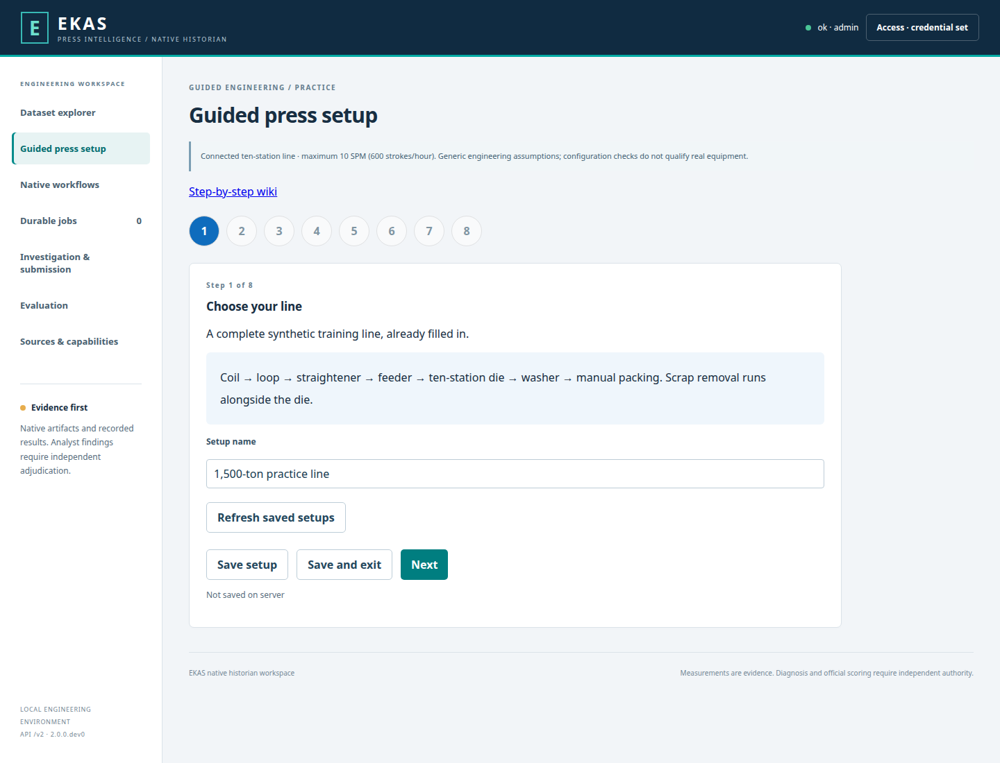
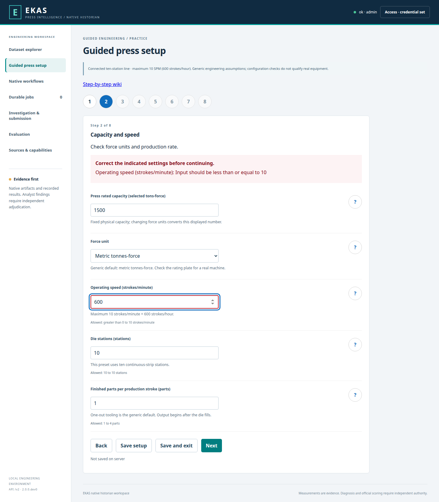
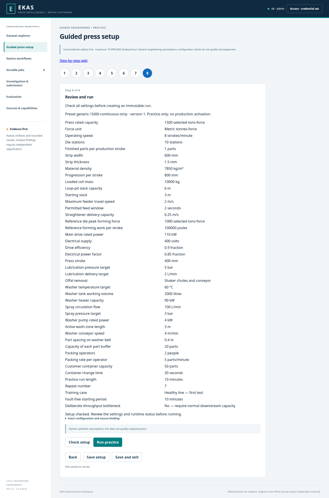

# 3. Guided configuration of the 1,500-ton line

[Wiki home](Home.md) · [Next: testing](04-Testing-and-results.md)

Open [the press-line wizard](http://127.0.0.1:18729/#setup). These are implemented screens. Use the installed address if working on another computer. The reference-only service on port 18728 shows the settings but correctly blocks Run because it lacks this plant.

Each screen shows a title, “Step X of 8” and a short explanation. Use **Next**, **Back**, **Save setup**, or **Save and exit**. Back appears after Step 1; Run replaces Next at the end. Completed steps are available in the progress list. After leaving, open guided setup and choose **Resume** beside your saved setup. The standard preset fills in every required setting. Essential help is visible; question-mark buttons provide extra explanations.

## Step 1 — Choose your line

1. Confirm the selected **Generic 1,500-ton continuous-strip press line**.
2. Read the equipment diagram and the prominent **Simulation only** label.
3. Enter a **Setup name**, for example “Training line”.
4. Choose **Next**.

Expected result: ten die stations and the complete reel-to-packing route are already selected. Tank and reactor examples cannot be mistaken for this preset.

## Step 2 — Confirm capacity and production speed

The screenshot deliberately shows a mistake: **600 entered as strokes per minute**. The error catches it. For the first test, enter **8**; 600 strokes **per hour** is the maximum of **10 per minute**.

1. Confirm the displayed force unit. The generic preset uses **1,500 metric tonnes-force**; this is an explicit assumption, not confirmed customer hardware. Switching to US short tons-force converts the displayed capacity and reference load while preserving the same physical forces. The fixed capacity is not editable.
2. Leave the initial operating speed at **8 strokes/minute** (a proposed training default).
3. Check the maximum: **10 strokes/minute**, also displayed as **600 strokes/hour**.
4. Leave **one finished part per completed production stroke** selected unless the tooling is multi-out. The preset allows ten strokes to fill the initially empty die before steady output begins.
5. Choose **Next**.

The application rejects speed above 10 SPM. Nominal capacity is a limit, not force applied on every stroke. Lower speed does not make an excessive die load acceptable.

## Step 3 — Confirm material supply and feeding

1. Confirm the route: reel → loop pit → multi-roll straightener → feeder → die.
2. Keep the standard sample material and progression unless deliberately changing the training case.
3. Check the displayed units for strip width, thickness and progression. “Progression” means distance advanced per stroke.
4. Leave loop capacity, reel controls and feeder timing at the preset values for your first run.
5. Choose **Next**.

Defaults are 600 mm width, 1.5 mm thickness, 800 mm progression, steel density 7,850 kg/m³, a 10,000 kg coil and a 6 m slack capacity starting at 3 m. These are generic assumptions, not customer dimensions. Changing material dimensions changes the resolved forming force/work; overloads are rejected. The summary shows the actual settings.

## Step 4 — Confirm die stations, lubrication and scrap handling

1. Inspect the ten numbered stations. The strip remains connected through the die.
2. Keep each station's standard part/strip presence sensing and forming-load model enabled.
3. Confirm lubrication zones and their pressure, flow and delivery confirmation.
4. Choose the installed scrap removal pattern: shaker chutes, motorized conveyors, or the preset combination.
5. Choose **Next**.

Station load channels represent the declared synthetic station instrumentation and occupancy-dependent load model. They are not inferred from a claim that ordinary corner sensors independently resolve every station. The reference recipe is 1,000 metric tonnes-force peak and 100,000 J work for the default geometry; actual demand scales with material dimensions and lubrication. See [the engineering basis](../../extensions/stamping_line/DESIGN.md) for fixed model assumptions and limitations.

## Step 5 — Confirm washing and manual packing

1. Confirm that finished parts leave the last station onto the washer-feed conveyor.
2. Keep **hot-water spray washer** selected. Review water temperature, spray flow/pressure, tank level, heating, pump and conveyor settings.
3. Review the queue capacities between press, washer and packing.
4. Confirm packing workers, their nominal packing rate, parts per customer container and container-change time.
5. Choose **Next**.

Packing is manual. Its rate can vary; it is not an automatic packer. The model must show what happens when washing or packing is slower than stamping. Customer-container identity is simulated training data.

The generic default is two people at six parts per minute each, 50 parts per container and 30 seconds to change containers. Including those changes, the nominal capacity is about 10.7 parts per minute, enough for the press's maximum 10 strokes per minute with one part per stroke. This is a training assumption, not a measured customer packing rate.

## Step 6 — Choose your test

1. For your first run keep **Healthy line — first test**.
2. Keep the recommended duration, repeat number and measurement settings.
3. For later tests choose one named problem, such as **Feeder slipping**. The fault-free starting period is an earliest baseline, not a promise of an exact onset; the native scheduler records the actual onset privately. Keep known answers hidden in a blind investigation.
4. Leave **Deliberate throughput bottleneck** at No for the first test. If you intentionally lower washer or packing capacity below press output, you must select Yes; the choice is saved with the run.
5. Choose **Next**.

The default is a 60-minute simulated practice run, repeat number 7. The screen does not predict an exact wall-clock duration. All wizard runs are labeled Practice, not qualification. Settings validation rejects a fault baseline that leaves less than two minutes for the fault; the native scheduler fits the actual episode inside the requested history.

## Step 7 — Choose where to view the result

1. Keep **Built-in workspace** for the first run. It needs no external application.
2. Read the connection note. A separate external EKAS application is not provisioned in this build; the wizard does not offer a fictional connection selector or success check.
3. Choose **Next**. To connect a separate application, follow [Connecting EKAS](05-Connecting-EKAS.md) with its maintainer.

An external application remains an explicit integration task until its editable source and response contract are supplied. This step uses the actual built-in workspace; there is no automatic switch to fictional demo data.

## Step 8 — Review and run

1. Read the line diagram and settings summary. Confirm ten stations and maximum 10 SPM.
2. Inspect the settings and assumptions. Use the completed-step buttons to return and edit.
3. Choose **Check setup**. The server checks the complete configuration and confirms whether the required runtime is available. Native execution separately checks resource limits; an exceeded limit fails visibly rather than changing the test.
4. When the checks pass, choose **Run practice** once.
5. The application opens the run-progress screen with your saved configuration version and job number.

If a field check fails, the wizard returns to its step, focuses the field and explains the correction. If the line runtime is absent, Run stays disabled with an installer message. You do not need raw JSON or a terminal to complete this workflow. Exact configuration/source hashes are available inside the optional **Exact configuration and source binding** section.

## Tooltips and help

Each unfamiliar setting has a short explanation available by mouse hover and keyboard focus. Essential instructions, units, bounds and errors remain visible on the page. Touch users can open an adjacent help button. Longer explanations link to this wiki. This follows [Microsoft Fluent 2 tooltip guidance](https://fluent2.microsoft.design/components/web/react/core/tooltip/usage) and [Field guidance](https://fluent2.microsoft.design/components/web/react/core/field/usage); a tooltip is supplemental help, not the only place an important rule appears.
