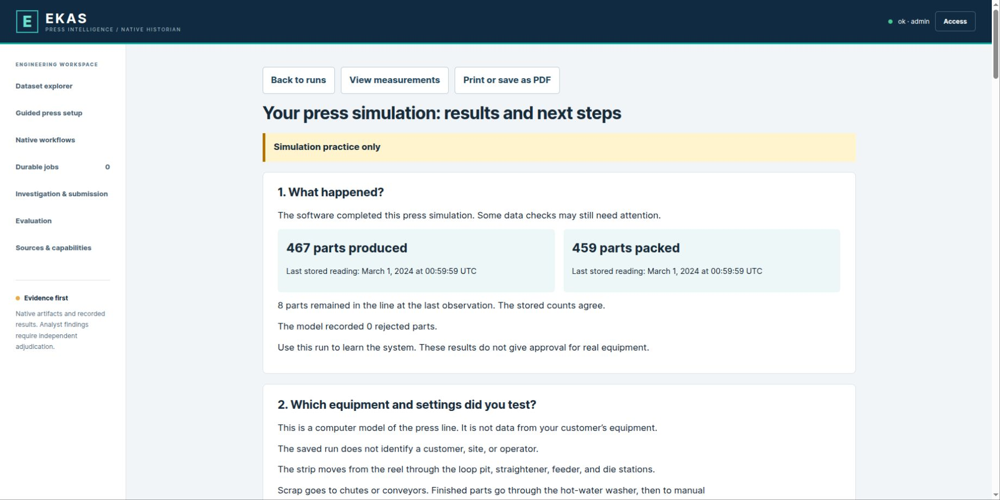

# 4. Run a test and understand the result

[Wiki home](Home.md) · [Next: connect EKAS](05-Connecting-EKAS.md)

## Your first press test

1. Open [Guided press setup](http://127.0.0.1:18729/#setup).
2. Keep the standard line settings and **Healthy line — first test**. The default history is 60 simulated minutes.
3. Follow all eight screens. At the end select **Check setup**, then **Run practice**.
4. In **Durable jobs**, wait for the recorded completion state and choose **Read my results**.
5. Read the report in order. It explains the settings, time period, graphs, part counts, check findings, and next steps.
6. Select **Print or save as PDF** if you need a copy. Use **View measurements** for the technical explorer.
7. In that explorer, select a signal and choose **Query measurements**. Use these signal names for a starting exercise:

| What to inspect | Signal |
|---|---|
| Press speed | `SIC-1500.PV` |
| Strokes and finished parts | `COUNT-STROKES`, `COUNT-PRODUCED` |
| Packed parts | `COUNT-PACKED` |
| Loop slack | `LI-LOOP` |
| Feeder shaft and strip travel | `ZI-FEED-SHAFT`, `ZI-FEED-STRIP` |
| Washer temperature | `TI-WASH` |
| Drive current | `II-DRIVE` |

Counts differ normally while parts fill the die, travel and await packing. Do not compare ten stations with ten finished parts per stroke. The first ten completed strokes fill the die before steady output; throughput is then nominally one finished part per stroke for one-out tooling.

## Read the plain-language report

**Read my results** is available to an administrator for each completed guided press run.
It does not run another simulation. It reads that run's saved settings and original stored observations.
The report includes separate graphs with real units, explanatory captions, a technical-term list, and the recorded check findings.
The report states that this is simulation practice. Successful generation does not mean that every check passed.

The part balance includes packed parts, rejected parts, and parts still on the conveyor, in the washer, or waiting for packing.
It needs usable final readings at the same time. Missing readings do not become zero.
The report shows the original observation times, so an earlier graph endpoint cannot silently become a final total.

Graphs show up to 960 selected stored points per signal. Summaries cover the full primary file.
Dots represent stored observations. They do not fill gaps or add interpolated values.
The source identifiers and hashes are available under **How was this report made?**

The wording uses ASD-STE100 Issue 9 as its reference. Full vocabulary and terminology review remains open.
This status is visible in the report. See the [language review](../PLAIN_REPORT_LANGUAGE_REVIEW.md).

The report contains setup information. It is not part of the blind analyst or independent evaluator workflow.
Backend applications can request `GET /v2/jobs/{job_id}/practice-report` with an administrator credential.
This read request returns the structured report without changing the run or its qualification status.

## Repeat with a feeder problem

1. Return to guided setup and choose **Start a new setup**, or edit a saved setup before submitting a new revision.
2. Keep the physical line settings unchanged.
3. At Step 6 choose **Feeder slipping**. Keep the fault-free starting period at 10 minutes and the history at 60 minutes.
4. Check and run. The scheduler chooses the actual episode after the clean baseline; it is not necessarily exactly minute ten.
5. Compare feeder shaft travel and actual strip travel, feed confirmation, press operation and downstream part counts with the healthy run.
6. Keep unavailable readings unavailable. Use independent observations to distinguish a sensor problem from physical slip.

The default healthy and feeder-slip 60-minute cases were run through the actual SDK and native worker on the development workstation. Both passed the model's engineering accounting and registered unqualified practice evidence. Healthy native findings included encoder noise and expected fault/twin divergence; the feeder case retained the encoder finding. All original validation results remain recorded.

**Healthy line** means no machine fault was injected. A native validation finding checks the model or its data; it does not automatically mean the virtual press has a machine fault. Read the practice status and measured signals together. The unresolved model checks still prevent production qualification.

## Recovery if the connection drops

Reopen guided setup and **Resume** the saved setup. The server records the submitted job with its exact setup revision. Retry uses that original revision/key; it must not silently start another job. Use the existing-run option to open **Durable jobs**. To deliberately start another test, choose **Start a new setup** or change and review a new configuration revision.

## Optional expert exercise with a reference model

This is a tank example. It verifies that you understand job submission and evidence viewing; it is not your press test. You may skip generation and explore an existing dataset instead.

1. Open **Native workflows** as an authorized administrator.
2. Set **Operation** to `generate`.
3. Set **Plant** to `heated_stirred_tank` and **Scenario** to `tank-clean`.
4. Set **Profile** to `quick` and **Seed** to `7`.
5. Leave **Native parameters / overrides (JSON object)** as `{}`. This technical field belongs to the expert tank example; the beginner press wizard uses labeled fields and needs no JSON.
6. Read **Request preview**. It should contain operation `generate`, scenario `tank-clean`, profile `quick`, seed `7`. Do not use this example to represent a press.
7. Select **Queue native job** once.
8. Open **Durable jobs**, find the new job number and watch its recorded progress. Browser reload does not cancel it.
9. If it fails, read the error and retain the evidence. Do not disable validation to obtain a green result.
10. If successful and registered, open its dataset from the job, or use **Refresh datasets** in the explorer and select the new record.
11. Query a measurement and inspect its quality, units and dates.

The `quick` profile is for practice. A clean scenario means no injected fault, not perfectly flat measurements; normal variability remains. Duration, runtime and validation outcomes depend on the selected model and host. Do not promise a fixed completion time.

## Additional press checks

After completing your first healthy/feeder comparison:

1. Complete [the eight setup steps](03-Guided-press-setup.md).
2. Run **Healthy line — first test**.
3. Check the flow from coil consumption to completed parts, washing, packing and scrap.
4. Check that actual speed stays within 10 SPM and that station occupation reflects die fill and transport delays.
5. Check that total production is accounted for across in-process parts, rejects, good parts and packed parts. Ten stations must not multiply production by ten.
6. Run a copy with **Feeder slipping**. Compare commanded feed, measured shaft travel, measured strip progression, station sensing and production effects.
7. Run downstream restriction examples: scrap blockage, washer stoppage and slower packing. Check queue growth and recorded stop reasons.
8. Save the configuration version, job number, run summary and relevant public evidence.

The connected model has numerical/native regression coverage and a nine-case native generation/audit set. Those are not the full diagnostic qualification campaign. The older press's qualification plan must be revised explicitly for 10 SPM; the old 45/60/75-SPM matrix cannot qualify this line.

## Export the same measurements

Enhanced and sparse exports use an existing dataset; they do not simulate the line again. Select a current line dataset, choose the profile and queue the export. Keep the new job/dataset number. Its source ID, timestamps, measured values and quality must match the original observations.

The current fully instrumented line declares no channels to withhold. Both profiles therefore retain all **85 channels**. The availability file explicitly records that no restriction was applied; selecting **Sparse** alone does not create a reduced-sensor experiment. Other plants can declare a withholding list. Never infer a sensor gap merely from the profile name.

Early development datasets contained fewer channels. If an export reports missing required channels, use a current generated line dataset or ask the maintainer to export with the original verified runtime. The exporter rejects missing required observations rather than inventing readings.

## Investigation and paid provider runs

Exploring measurements does not require asking an external AI provider. **Queue blind analysis** and **Queue independent evaluation** can send authorized evidence to a configured provider and incur cost. Use them only under the agreed data-sharing and budget authorization. Do not enter private customer data into a training run without the customer's agreed handling arrangements.

For a blind test, the analyst sees public measured evidence and not the simulator's hidden fault schedule. A separate evaluator judges frozen claims. A completed provider job is not proof that a proposed cause is correct. Frozen submissions cannot be edited in place; use a new run/dataset for a new trial.

## Save, cancel and repeat

Use the recorded job number to return to a run. A client timeout only means the client stopped waiting; check the existing job before submitting again. Administrators can request cancellation in the job controls; wait for the recorded terminal status. Cancelled or interrupted output is not qualified data. Repeatable comparisons need the same configuration version, seed and runtime source; changing one must be visible in the result.
